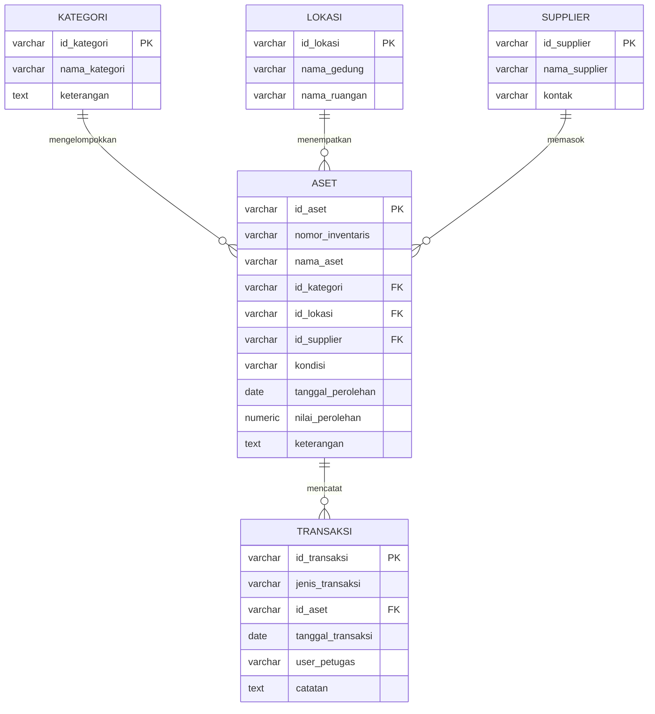
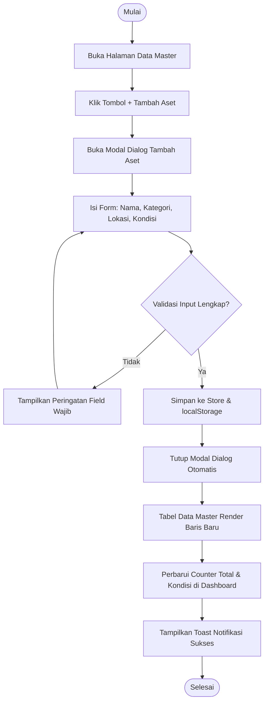

# Dokumen Perancangan Antarmuka Sistem Informasi
## SaranaPrasana - Asset Management System

- Mata kuliah: Pemrograman Web 2
- Proyek: UAS - Admin Panel Manajemen Sarana dan Prasarana
- Target: Milestone 1 - 3
- Versi dokumen: 2.1.0 (Clean Architecture & Single-Door Modal)
- Pendekatan: Client-side web application, HTML5, CSS3, JavaScript murni, Chart.js, dan Docker PostgreSQL 16
- Gaya UI: Modern Enterprise SaaS dengan aksen Clean Blueprint Slate
- Bahasa antarmuka: Bahasa Indonesia

Dokumen ini menjadi acuan tunggal untuk struktur informasi, arsitektur menu, desain visual, slicing HTML/CSS, dan implementasi interaksi. Seluruh data awal terhubung dengan persistensi localStorage serta tersinkronisasi dengan skema PostgreSQL di Docker.

---

## 1. Deskripsi Sistem dan Ruang Lingkup

### 1.1 Latar Belakang
SaranaPrasana merupakan aplikasi admin panel back-office untuk membantu institusi, universitas, atau organisasi mengelola inventaris aset secara transparan, akurat, dan terstruktur. Sistem menyediakan rekapitulasi dashboard, pencatatan data master aset, pemantauan kondisi fisik, dan laporan inventarisasi resmi (KIR).

### 1.2 Tujuan Perancangan
1. Menyajikan dashboard eksekutif informatif dengan kartu KPI, grafik analitik kondisi aset, sebaran kategori, aktivitas log terbaru, dan lokasi aset.
2. Menyediakan modul Data Master Aset dengan alur CRUD cepat satu pintu menggunakan Modal Popup langsung di tabel tanpa redirect halaman.
3. Menghilangkan redundansi menu agar tidak ada duplikasi antara modul Data Master dan Transaksi.
4. Menyediakan modul Laporan Inventarisasi (KIR) yang dapat difilter, diekspor ke CSV, dan dicetak rapi via dialog cetak browser.
5. Menghasilkan antarmuka responsif adaptif untuk desktop, tablet, dan smartphone dengan basis styling kanonikal terpusat di assets/css/style.css.

### 1.3 Batasan Sistem
- Data persistensi klien menggunakan localStorage browser.
- Skema database relasional telah dimigrasikan dan berjalan di container Docker PostgreSQL 16 (saranaprasana-postgres, port 5435).
- Pengujian koneksi backend database dapat diverifikasi langsung melalui skrip database/test-db.js.
- Ekspor laporan mendukung format CSV dan cetak langsung (window.print()) dengan layout media print khusus.

---

## 2. Hirarki Menu dan Arsitektur Navigasi (Anti-Duplikasi)

Struktur menu sidebar dirancang dengan prinsip Single Responsibility: setiap modul memiliki fungsi unik tanpa rute ganda yang membingungkan.

```text
SaranaPrasana
├── Login / Gerbang Masuk (index.html)
├── Dashboard Eksekutif (pages/dashboard.html)
├── Data Master
│   ├── Data Aset (Tabel 10 Aset + Modal Popup Tambah & Edit)
│   ├── Kategori Aset (Filter Komputer, Elektronik, dll.)
│   ├── Lokasi (Filter Gedung A, B, C, Luar Gedung)
│   └── Supplier (Rekanan Resmi)
├── Transaksi
│   ├── Pemeliharaan (Aset Dalam Perawatan / Servis)
│   └── Mutasi Aset (Perpindahan Antar Ruang)
├── Laporan
│   └── Laporan Aset (Rekapitulasi KIR & Ekspor CSV)
└── Pengaturan
    └── Konfigurasi Sistem
```

### Analisis Solutif: Kenapa Tambah Data Dijadikan Modal Popup Satu Pintu?
Pada perancangan awal, form tambah data dipisah ke modul Transaksi > Pengadaan, sementara di tabel Data Master juga terdapat tombol Tambah Aset. Alur ini menciptakan duplikasi yang membingungkan pengguna.
Oleh karena itu, sistem distandarkan ke pola Single-Door CRUD:
- Tombol '+ Tambah Aset' diletakkan secara kanonikal di halaman Data Master.
- Saat tombol diklik, sistem langsung memunculkan Modal Popup Tambah Aset di atas layar yang sama tanpa reload atau redirect.
- Modul Transaksi difokuskan murni untuk pencatatan siklus aset operasional (Pemeliharaan dan Mutasi), sehingga tidak ada komponen yang tumpang tindih.

---

## 3. Skema Basis Data Relasional (PostgreSQL 16)



---

## 4. Alur Interaksi Pengguna (Activity Diagram)



---

## 5. Implementasi Teknis & Lingkungan Docker

- Container Docker: saranaprasana-postgres (PostgreSQL 16)
- Port Host: 127.0.0.1:5435 (Internal: 5432)
- Database: saranaprasana
- User: sarpras
- Password: sarpras_uas_2026
- Skrip Verifikasi: database/test-db.js (Dijalankan via npm run test-db)

Semua stylesheet telah dikonsolidasikan secara murni ke dalam assets/css/style.css sehingga tidak ada lagi dependensi terhadap browser default styling yang tidak teratur.
