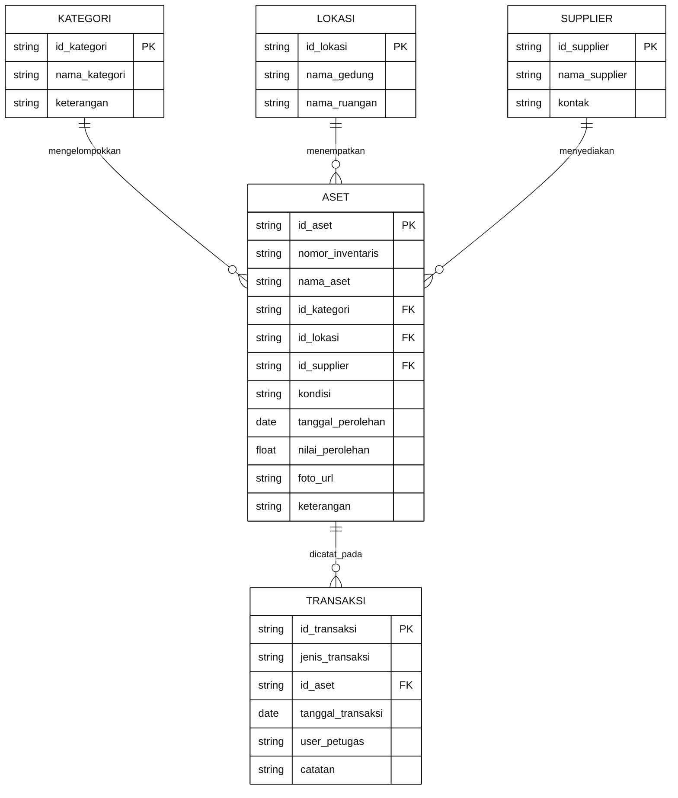
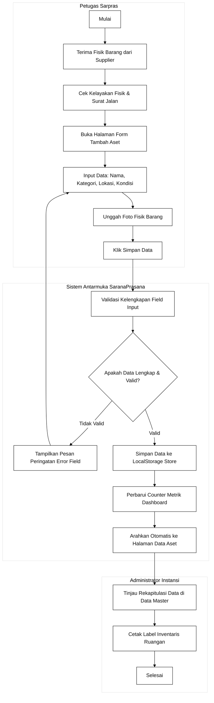
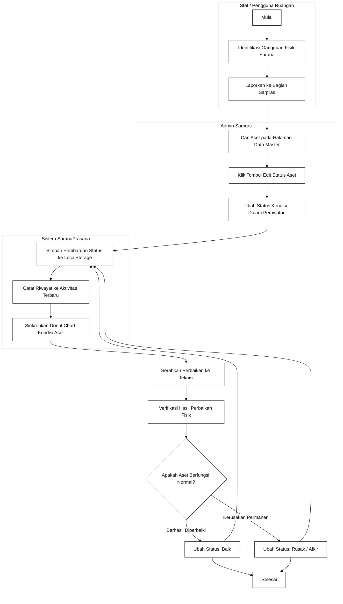
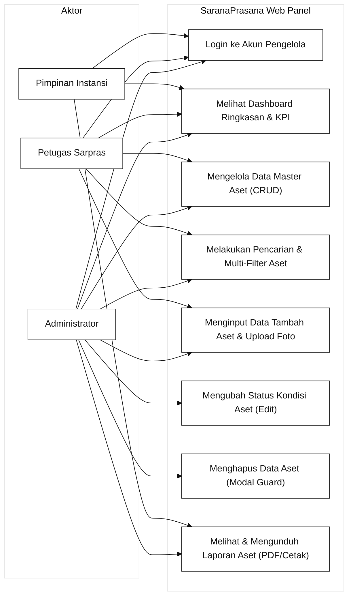

# Dokumen Perancangan Antarmuka Sistem Informasi
## SaranaPrasana - Asset Management (v1.0.0)
**Mata Kuliah:** Pemrograman Web 2  
**Target Milestone:** Milestone 1 (Perencanaan Menu, ER-D, Diagram Swimlane, dan Design System)  
**Pendekatan Arsitektur:** Client-Side Web Application (HTML5 Semantik, CSS3 Modern, Vanilla JavaScript)  
**Tema Desain:** Modern Clean Enterprise SaaS (Sesuai Showcase Spesifikasi SaranaPrasana)  

---

## 1. Deskripsi Sistem dan Ruang Lingkup

### 1.1 Latar Belakang
SaranaPrasana (Asset Management) adalah sistem informasi berbasis web sisi klien (client-side) yang dirancang untuk mendukung pengelolaan sarana dan prasarana di lingkungan instansi, universitas, atau korporasi secara efektif, efisien, dan transparan. Sistem ini mengintegrasikan seluruh siklus inventaris mulai dari pencatatan pengadaan baru, pemantauan kondisi kelayakan fisik, pencatatan mutasi lokasi, hingga penerbitan laporan berkala.

### 1.2 Tujuan Perancangan
1. Merancang antarmuka admin panel yang bersih, ergonomis, dan intuitif dengan hierarki visual terstruktur.
2. Memfasilitasi visualisasi ringkasan inventaris instansi secara real-time melalui kartu metrik KPI dan grafik komparasi interaktif (Chart.js).
3. Menyediakan pengelolaan data master aset yang cepat dengan kapabilitas pencarian, multi-filter (kategori, lokasi, kondisi), paginasi, dan manipulasi data lokal (localStorage).
4. Menyediakan formulir registrasi dua kolom dengan pratinjau gambar dan validasi input sisi klien.
5. Menyediakan modul laporan inventaris yang siap cetak dan dapat diunduh dalam format PDF/CSV.

### 1.3 Karakteristik Pengguna
* **Administrator:** Mengelola seluruh data master aset (tambah, edit, hapus), memvalidasi perubahan status pemeliharaan, dan mengunduh laporan rekapitulasi.
* **Petugas Sarpras:** Melakukan audit fisik berkala, mencatat perpindahan mutasi aset antar-gedung/ruangan, dan memperbarui kondisi barang.
* **Pimpinan Instansi:** Memantau ringkasan eksekutif kesehatan sarana prasarana melalui dashboard KPI dan grafik analitik.

---

## 2. Hirarki dan Struktur Menu (Information Architecture)

Struktur menu SaranaPrasana disusun secara modular dengan navigasi vertikal tetap (persistent sidebar) bernuansa Dark Slate Navy (`#1E293B`) di sisi kiri, didukung bilah pencarian dan utilitas di sisi atas:

```text
SaranaPrasana Admin Panel
├── 0. Autentikasi Masuk (index.html)
│   ├── Panel Kiri: Identitas Brand & Foto Arsitektur Modern
│   └── Panel Kanan: Form Login (Username, Password, Ingat Saya, Login SSO)
│
├── 1. Dashboard Utama (pages/dashboard.html)
│   ├── Banner Sambutan: "Selamat Datang, Admin" & Penunjuk Tanggal
│   ├── Kartu Ringkasan KPI:
│   │   ├── Total Aset: 248 (+12% dari bulan lalu)
│   │   ├── Aset Aktif: 230 (+10% dari bulan lalu)
│   │   ├── Aset Rusak: 8 (-2% dari bulan lalu)
│   │   └── Aset Dalam Perawatan: 10 (+5% dari bulan lalu)
│   ├── Visualisasi Grafik Analitik:
│   │   ├── Kondisi Aset (Donut Chart: Baik 72%, Rusak 3%, Perawatan 4%, Lainnya 21%)
│   │   └── Aset per Kategori (Bar Chart: Komputer 60, Kendaraan 45, Alat Kantor 38, Elektronik 32, Furniture 18)
│   ├── Widget Aktivitas Terbaru (Log Pengadaan, Pemeliharaan, Mutasi)
│   └── Widget Persebaran Lokasi Aset (Gedung A: 98, Gedung B: 76, Gedung C: 42, Luar Gedung: 32)
│
├── 2. Data Master (pages/data-master.html)
│   ├── Header: Judul "Data Aset", Tombol Aksi "+ Tambah Aset"
│   ├── Bilah Filter: Dropdown Kategori, Dropdown Lokasi, Dropdown Kondisi, Input Pencarian
│   ├── Tabel Inventaris (Data A-001 s/d A-010, Checkbox, Kolom Aksi Edit & Hapus)
│   ├── Modal Konfirmasi Hapus Aset (Destructive Guard)
│   └── Footer Paginasi: "Menampilkan 1 - 10 dari 248 data", Kontrol Navigasi Halaman
│
├── 3. Transaksi & Tambah Aset (pages/form.html)
│   ├── Tombol Kembali ke Data Master
│   ├── Kolom Kiri (Informasi Dasar):
│   │   ├── Nama Aset, Kategori, Nomor Inventaris, Lokasi
│   │   └── Kondisi, Tanggal Perolehan, Supplier, Keterangan Tambahan
│   ├── Kolom Kanan (Upload Gambar & Aksi):
│   │   ├── Zona Drag & Drop Unggah Foto Aset (JPG/PNG maks 2MB)
│   │   ├── Kartu Pratinjau Foto Aset Terunggah
│   │   └── Tombol Aksi: Batal & Simpan Data Aset
│   └── Validasi Formulir Interaktif Sisi Klien
│
├── 4. Pusat Laporan (pages/laporan.html)
│   ├── Pemilihan Rentang Tanggal Periode Laporan (Contoh: 01/10/2025 - 31/10/2025)
│   ├── Tombol "Unduh Laporan" & "Export PDF"
│   ├── Ringkasan Metrik Laporan (248 Total Aset, 230 Aktif, 8 Rusak, 10 Perawatan)
│   ├── Grafik Ringkasan Kondisi & Persebaran Lokasi
│   └── Tabel Detail Laporan Inventaris Siap Cetak (@media print)
│
└── 5. Template Master Shell (layout.html)
    ├── Komponen Kerangka Responsif (Sidebar Drawer, Header, Viewport, Footer)
    └── Pengalih Tema Gelap / Terang (Persistensi LocalStorage)
```

---

## 3. Konsep Entity Relationship Diagram (ER-D)

Sesuai ketentuan tugas (Client-Side / No-Backend), skema entitas berikut diimplementasikan ke dalam struktur objek JavaScript (`assets/js/data-mock.js`) dan disimpan pada `localStorage` peramban web:



---

## 4. Diagram Alur Kerja Bisnis (UML Activity Swimlane)

### 4.1 Swimlane Alur Pengadaan dan Registrasi Aset Baru
Diagram ini memetakan tahapan mulai dari penerimaan barang, penginputan metadata formulir, hingga verifikasi masuk ke data master inventaris.



### 4.2 Swimlane Alur Pemeliharaan dan Perubahan Status Aset
Diagram ini memetakan tindakan penanganan ketika barang mengalami kerusakan hingga selesai diperbaiki.



---

## 5. Use Case Diagram Sistem



---

## 6. Design System dan Arsitektur UI (Spesifikasi Showcase)

### 6.1 Palet Warna Baku (Color Palette Tokens)
| Token Nama | Nilai HEX | Peran & Penggunaan |
| :--- | :--- | :--- |
| `color-primary` | `#1F46E5` | Tombol CTA primer, indikator navigasi aktif, dan aksen fokus utama. |
| `color-secondary` | `#06B6D4` | Aksen grafis sekunder, badge informasi, dan elemen visual pendukung. |
| `color-accent` | `#F59E0B` | Sorotan kartu metrik, status perhatian, dan aksen visual. |
| `color-success` | `#10B981` | Status Aset Baik, badge Pengadaan, indikator pertumbuhan persentase. |
| `color-warning` | `#F97316` | Status Dalam Perawatan, badge tiket servis aktif. |
| `color-danger` | `#EF4444` | Status Aset Rusak, tombol hapus, modal konfirmasi kritis. |
| `color-bg-canvas` | `#F8FAFC` | Latar belakang kanvas ruang kerja (Slate 50). |
| `color-surface-card`| `#FFFFFF` | Latar belakang kartu kontainer putih dengan soft drop shadow. |
| `color-border` | `#E2E8F0` | Garis batas 1px pada kontainer kartu, tabel, dan kolom input. |
| `color-sidebar-bg` | `#1E293B` | Latar belakang bilah navigasi samping (Dark Slate Navy). |
| `color-text-title` | `#0F172A` | Teks judul utama, angka kuantitas metrik, dan teks tebal (Slate 900). |
| `color-text-muted` | `#64748B` | Subjudul, label sekunder, dan teks placeholder (Slate 500). |

### 6.2 Skala Tipografi (Font Family: Inter)
* **Bold (24px):** Judul utama halaman (`h1.page-title`).
* **Semibold (18px):** Subjudul bagian kartu data dan header modal dialog.
* **Medium (16px):** Label item menu navigasi dan judul widget analitik.
* **Regular (14px):** Teks paragraf, sel tabel data inventaris, dan input formulir.
* **Caption (12px):** Label kecil, timestamp log aktivitas, dan teks bantuan.

### 6.3 Daftar 8 Fitur Utama Sesuai Showcase
1. Dashboard interaktif (Chart.js & ringkasan statistik)
2. Data master aset (Tabel lengkap dengan aksi CRUD)
3. Form input dan edit dengan validasi JavaScript
4. Laporan dan detail aset (Format cetak resmi / unduh PDF)
5. Sidebar responsif dengan tombol toggle
6. Modal dialog konfirmasi hapus data
7. Notifikasi dan indikator status real-time
8. Desain modern clean enterprise dengan subtle glassmorphism

---

## 7. Rincian Spesifikasi Layar

### 7.1 Halaman Login (index.html)
* **Layout Split-Screen 50:50:**
  * Sisi Kiri: Foto fasad gedung kantor modern beresolusi tinggi dengan overlay gradient navy, memuat logo SaranaPrasana, headline "Kelola Sarana & Prasarana dengan Lebih Mudah", dan deskripsi nilai sistem.
  * Sisi Kanan: Kartu form putih bersih dengan kolom Username, Password (toggle mata intip sandi), checkbox Ingat Saya, tautan Lupa Password, tombol Login primer, dan tombol Login dengan SSO.

### 7.2 Halaman Dashboard (pages/dashboard.html)
* **Banner Hero Sambutan:** "Selamat Datang, Admin 👋" dengan deskripsi ringkasan kondisi sarana dan pill penunjuk tanggal hari ini ("Sen, 13 Okt 2025").
* **4 Kartu Ringkasan Metrik:**
  1. Total Aset: 248 (+12% dari bulan lalu)
  2. Aset Aktif: 230 (+10% dari bulan lalu)
  3. Aset Rusak: 8 (-2% dari bulan lalu)
  4. Aset Dalam Perawatan: 10 (+5% dari bulan lalu)
* **Visualisasi Grafik (Chart.js):**
  * Kondisi Aset (Donut Chart dengan titik tengah "248 Total Aset" dan breakdown persentase: Baik 72%, Rusak 3%, Perawatan 4%, Hilang 1%, Lainnya 20%).
  * Aset per Kategori (Bar Chart: Komputer 60, Kendaraan 45, Peralatan Kantor 38, Elektronik 32, Furniture 18).
* **Widget Aktivitas Terbaru:** Feed pembaruan terkini (Pengadaan Laptop ThinkPad, Servis AC Ruang Rapat, Mutasi Printer HP).
* **Widget Lokasi Aset:** Distribusi unit pada Gedung A (98), Gedung B (76), Gedung C (42), dan Luar Gedung (32).

### 7.3 Halaman Data Aset (pages/data-master.html)
* **Header:** Breadcrumb `Dashboard > Data Master > Aset`, judul "Data Aset", dan tombol "+ Tambah Aset".
* **Filter Bar:** Dropdown "Semua Kategori", Dropdown "Semua Lokasi", Dropdown "Semua Kondisi", dan input pencarian teks instan.
* **Tabel Master:** Kolom Checkbox, No, Nama Aset, Kategori, Lokasi, Kondisi (Badge pill), Tgl Perolehan, dan Aksi (Edit / Delete).
* **Dataset Mock Terdaftar:** Data A-001 s/d A-010 sesuai spesifikasi baku.
* **Paginasi:** Informasi "Menampilkan 1 - 10 dari 248 data" dan navigasi halaman.

### 7.4 Halaman Tambah Aset (pages/form.html)
* **Tata Letak 2 Kolom:**
  * Kolom Kiri: Input Nama Aset, Kategori, Nomor Inventaris, Lokasi, Kondisi, Tanggal Perolehan, Supplier, dan Keterangan opsional.
  * Kolom Kanan: Dropzone seret-dan-lepas unggah foto aset, thumbnail pratinjau gambar, serta tombol Batal dan Simpan.

### 7.5 Halaman Laporan Aset (pages/laporan.html)
* **Bilah Kontrol:** Filter rentang tanggal periode (01/10/2025 - 31/10/2025) dan tombol aksi "Unduh Laporan".
* **Ringkasan Analitik:** 4 kartu metrik mini, donut chart kondisi, dan grafik batang lokasi terbanyak.
* **Tabel Detail:** Pratinjau riwayat inventaris dengan tombol "Export PDF" dan dukungan cetak langsung (`window.print()`).

---

## 8. Tautan Rancangan dan Bukti Visual

* **Tautan Publik Google Stitch Project:**  
  [https://stitch.withgoogle.com/projects/5290689202880346844](https://stitch.withgoogle.com/projects/5290689202880346844)  
  *Nama Project:* SIM Sarpras Asset Management  
  *ID Project:* 5290689202880346844

* **Bukti Visual Tangkapan Layar Wireframe (Tersimpan Lokal di Repositori):**
  1. **Dashboard Eksekutif:** `assets/img/stitch_dashboard.png`  
     
  2. **Data Master Inventaris:** `assets/img/stitch_datamaster.png`  
     
  3. **Formulir Registrasi Aset:** `assets/img/stitch_form.png`  
     
  4. **Pusat Laporan & KIR:** `assets/img/stitch_laporan.png`  
     
  5. **Portal Login:** `assets/img/stitch_login.png`  
     

* **Status Tautan Figma:**  
  Rancangan wireframe dan spesifikasi token warna serta tata letak mengacu pada Google Stitch Project ID `5290689202880346844` dan dokumen `docs/DESIGN.md`. Tautan publik Figma dapat disematkan secara mandiri oleh mahasiswa setelah membagikan file kerja Figma pribadi (tidak mencantumkan URL fiktif untuk menghindari galat 404).

* **Aset Latar Belakang & Visual:**  
  Tersimpan secara lokal pada repositori: `assets/img/login-bg.jpg` (Arsitektur gedung resolusi tinggi, siap offline 100%).

---
*Dokumen ini disusun sebagai luaran resmi Milestone 1 Tugas Proyek UAS Pemrograman Web 2 dan menjadi acuan baku tahap slicing (Milestone 2) dan implementasi interaktivitas JavaScript (Milestone 3).*
