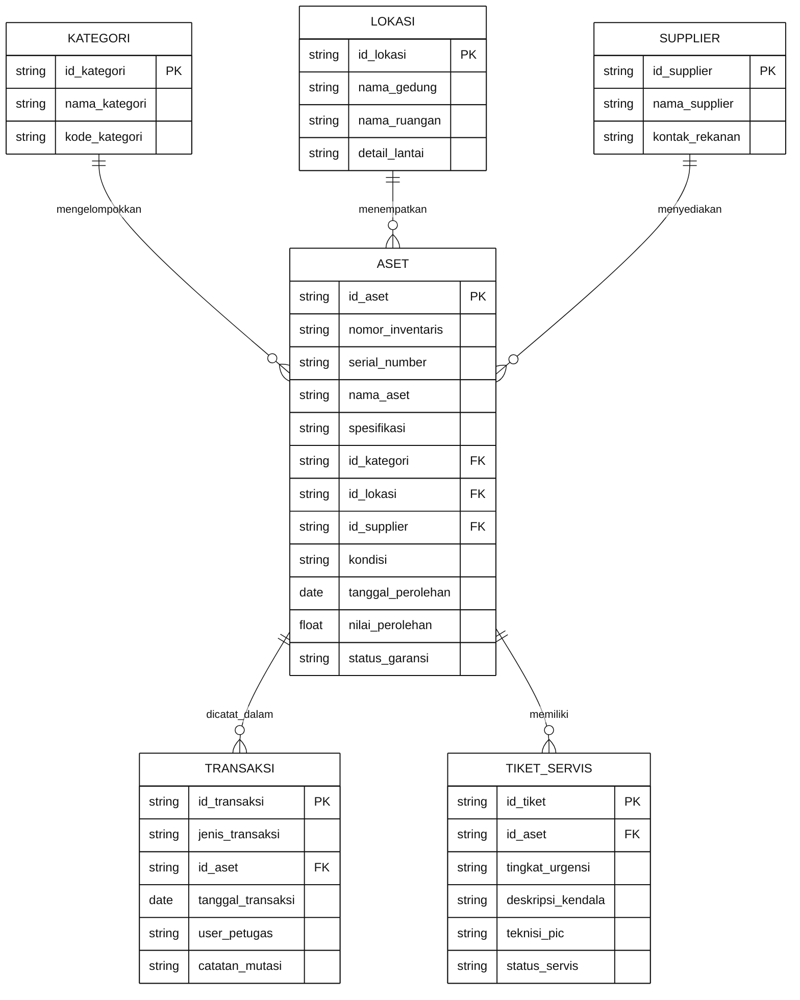
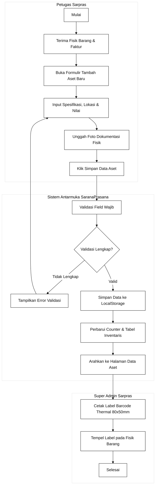
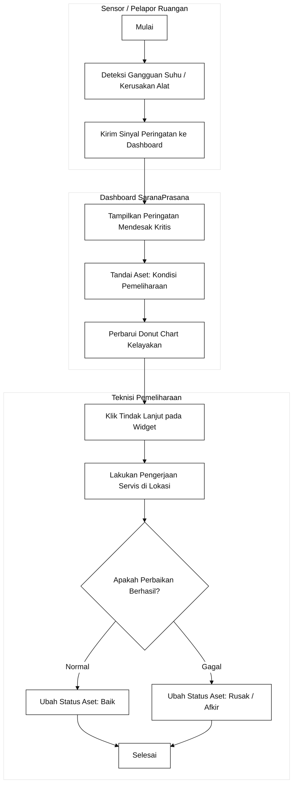
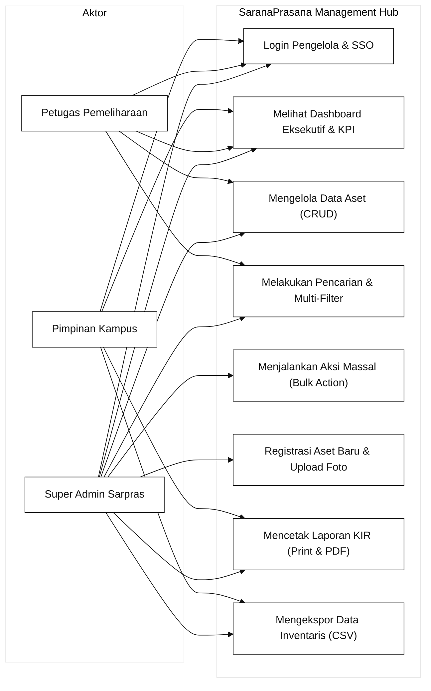

# Dokumen Perancangan Antarmuka Sistem Informasi
## SaranaPrasana - Asset Management (v1.0.0)
**Mata Kuliah:** Pemrograman Web 2  
**Target Milestone:** Milestone 1 (Perencanaan Menu, ER-D, Diagram Swimlane, dan Design System)  
**Pendekatan Arsitektur:** Client-Side Web Application (HTML5 Semantik, Tailwind CSS, Vanilla JavaScript)  
**Acuan Resmi Desain:** Google Stitch Project ID `8744053701019094011` (Sarana Enterprise Ops)  

---

## 1. Deskripsi Sistem dan Ruang Lingkup

### 1.1 Latar Belakang
SaranaPrasana (Asset Management) adalah sistem informasi berbasis web sisi klien (client-side) yang dirancang untuk mendukung tata kelola sarana dan prasarana di lingkungan kampus dan perguruan tinggi (dikonfigurasi untuk instansi Telkom / Kampus Utama). Sistem ini memfasilitasi seluruh siklus hidup inventaris mulai dari pencatatan pengadaan baru, pemantauan kondisi kelayakan fisik, penjadwalan pemeliharaan preventif, penanganan peringatan kerusakan, hingga penerbitan laporan Kartu Inventaris Ruangan (KIR) secara akuntabel.

### 1.2 Tujuan Perancangan
1. Mengembangkan tata letak antarmuka admin panel yang bersih, berdensitas tinggi, dan ergonomis dengan hierarki visual terstruktur sesuai tema Sarana Enterprise Ops.
2. Membangun visualisasi data ringkasan inventaris kampus secara real-time menggunakan kartu metrik KPI, distribusi kategori aset, rasio kelayakan donut chart, dan log aktivitas pergerakan aset.
3. Menyediakan manajemen data master inventaris yang responsif dengan fitur pencarian teks instan, multi-filter (kategori, lokasi, kondisi), seleksi massal (bulk action), dan manipulasi data lokal (localStorage).
4. Menyediakan formulir registrasi dua kolom dengan pratinjau gambar dan simulasi barcode/QR label thermal BMN.
5. Menyediakan modul laporan inventaris yang siap cetak dan dapat diunduh (PDF / CSV) untuk keperluan audit akreditasi institusi.

### 1.3 Karakteristik Pengguna
* **Super Admin Sarpras (Rian Hidayat, S.Kom.):** Mengelola seluruh data master inventaris, menindaklanjuti peringatan insiden kritis, dan menyetujui mutasi penempatan barang.
* **Petugas Pemeliharaan / Teknisi:** Memperbarui tiket servis, mencatat jadwal perawatan genset/AC/server, dan memverifikasi status kelayakan aset.
* **Pimpinan Instansi / Dekanat:** Memantau ringkasan eksekutif aset aktif, estimasi nilai depresiasi buku, dan mengunduh laporan rekapitulasi semesteran.

---

## 2. Hirarki dan Struktur Menu (Information Architecture)

Struktur navigasi SaranaPrasana menggunakan sidebar vertikal tetap (persistent rail) Dark Slate Navy (`#101828`) di sisi kiri yang dikelompokkan ke dalam 5 rumpun kerja utama:

```text
SaranaPrasana Admin Panel (Stitch 8744053701019094011)
├── 0. Portal Autentikasi (index.html)
│   ├── Panel Kiri: Identitas Brand, Logo Hexagon, & Tag "Telkom / Kampus Utama"
│   └── Panel Kanan: Form Login (Username, Password, Ingat Saya, Akses Demo)
│
├── 1. Dashboard Utama (pages/dashboard.html)
│   ├── Topbar: Breadcrumbs, Pencarian Universal (Ctrl K), Status TA 2024/2025 Genap, Notifikasi
│   ├── Hero Welcome: "Selamat Datang, Admin 👋" & Badge "Sistem Siap"
│   ├── 4 Kartu Metrik KPI:
│   │   ├── Total Aset Terdaftar: 248 unit (Rp 1,42 Miliar | +12 unit bulan ini)
│   │   ├── Aset Aktif & Layak: 230 unit (92,7% Normal | Optimal)
│   │   ├── Aset Kendala / Rusak: 8 unit (4 Rusak Ringan, 4 Rusak Berat)
│   │   └── Sedang Dipelihara: 10 unit (Estimasi selesai 3 hari)
│   ├── Analitik Visual:
│   │   ├── Distribusi Kategori Aset (Bar Chart Progress & Nilai Depresiasi)
│   │   └── Kondisi Fisik Aset (Donut Chart: 86.7% Baik, 4.0% Pemeliharaan, 3.2% Rusak, 6.1% Penghapusan)
│   ├── Widget Operasional:
│   │   ├── Peringatan Mendesak (3 Kritis: Server Dell, Projector Epson, AC Daikin)
│   │   ├── Distribusi per Lokasi (Gedung B, Gedung C, Gedung A, Perpustakaan, Parkir)
│   │   └── Aktivitas Terbaru (Log Mutasi, Servis, & Registrasi Aset)
│   └── Pintasan Cepat Operasional: Batch Scan QR, Cetak Label Barcode, Audit BAST
│
├── 2. Data Master (pages/data-master.html)
│   ├── Breadcrumb: Beranda > Data Master > Data Aset
│   ├── Header: Judul "Data Aset", Tombol Scan QR, Visibilitas Kolom, Export Data, + Tambah Aset
│   ├── Bilah Filter & Pencarian:
│   │   ├── Input Search, Filter Kategori, Filter Lokasi Kampus, Filter Kondisi, Tombol Reset
│   │   └── Penyaring Cepat: Aset Kritis, Garansi Aktif, Baru Ditambahkan, Perlu Servis
│   ├── Bilah Aksi Massal (Floating Bulk Action Bar saat baris dipilih):
│   │   └── Cetak Label Barcode, Mutasi Lokasi, Jadwalkan Servis, Hapus Masal
│   ├── Tabel Data Inventaris (9 Kolom Lengkap, Checkbox, Status Badge, Aksi Inline)
│   ├── Modal Detail & Modal Edit Aset
│   ├── Modal Konfirmasi Hapus Aset (Destructive Guard)
│   └── Paginasi: "Menampilkan 1-10 dari 248 data", Baris per Halaman, Tombol Nomor Halaman
│
├── 3. Transaksi & Registrasi Baru (pages/form.html)
│   ├── Tombol Kembali ke Data Aset
│   ├── Kolom Kiri (Spesifikasi Data):
│   │   ├── Nama Barang, Nomor Inventaris (Auto), Serial Number (SN) / Plat
│   │   ├── Kategori, Kondisi Fisik, Spesifikasi Teknis
│   │   └── Gedung, Ruangan Spesifik, Tanggal Pengadaan, Nilai Perolehan, Garansi, Supplier
│   ├── Kolom Kanan (Dokumentasi & Simulasi):
│   │   ├── Drag & Drop Zona Upload Foto Fisik
│   │   └── Simulasi Label Barcode Thermal Resmi BMN (80 x 50 mm)
│   └── Action Bar: Batal & + Simpan Data Aset
│
├── 4. Pusat Laporan & Rekapitulasi (pages/laporan.html)
│   ├── Filter Rentang Periode Laporan (01/10/2025 - 31/10/2025)
│   ├── Tombol Export CSV & Tombol Cetak Dokumen (KIR)
│   ├── Ringkasan 4 Kartu Metrik Laporan
│   ├── Tabel Buku Inventaris Resmi
│   ├── Format Kop Surat Kedinasan (@media print)
│   └── Lembar Pengesahan Tanda Tangan Ganda (Kepala Biro Sarpras & PIC Ruangan)
│
└── 5. Master Layout Skeleton (layout.html)
    ├── Master Shell Responsif Berbasis Google Stitch 8744053701019094011
    └── Modal Dialog Aksesibel
```

---

## 3. Konsep Entity Relationship Diagram (ER-D)



---

## 4. Diagram Alur Kerja Bisnis (UML Activity Swimlane)

### 4.1 Swimlane Alur Pengadaan dan Registrasi Aset Baru


### 4.2 Swimlane Alur Penanganan Peringatan Kritis & Pemeliharaan


---

## 5. Use Case Diagram Sistem



---

## 6. Design System dan Arsitektur UI (Spesifikasi Stitch 8744)

* **Tema Desain:** Sarana Enterprise Ops (Google Stitch Project ID `8744053701019094011`).
* **Sidebar:** Deep Dark Slate Navy (`#101828`), Active Indicator (`#18243A` & `#3B82F6`).
* **Ruang Kerja:** Cool Grey-Blue Canvas (`#F5F7FB`), Kartu Putih Bersih (`#FFFFFF`), Border Hairline (`#E6EAF0`).
* **Warna Aksi Primer:** Electric Blue (`#3B82F6` / `#0058be`), Hover (`#2563EB`).
* **Status Semantik:** Baik (`#10B981`), Pemeliharaan (`#F59E0B`), Rusak (`#EF4444`).
* **Tipografi:** `Plus Jakarta Sans` (Display & Headings) + `Inter` (Body & Tabular).

---

## 7. Tautan Rancangan Aktual dan Bukti Wireframe

* **Tautan Publik Google Stitch Project (Aktual & Terverifikasi Langsung):**  
  [https://stitch.withgoogle.com/projects/8744053701019094011](https://stitch.withgoogle.com/projects/8744053701019094011)  
  *Nama Project:* SaranaPrasana Admin Dashboard UI  
  *ID Project:* 8744053701019094011  
  *Status:* Publik (Verified via Stitch API)

* **Daftar Layar Resmi di Dalam Project Stitch:**
  1. **Dashboard - SaranaPrasana** (Screen ID: `139e310a49cf4143af66cc8407a25b1b`)  
     Tersimpan lokal di repositori: `assets/img/stitch_dashboard_8744.png`
  2. **Data Aset - SaranaPrasana** (Screen ID: `dcb4123bf53143679952e42c5a5b0442`)  
     Tersimpan lokal di repositori: `assets/img/stitch_dataaset_8744.png`

* **Status Tautan Figma:**  
  Rancangan visual dan token desain baku berpusat penuh pada Google Stitch Project ID `8744053701019094011` serta dokumen `docs/DESIGN.md`. Mahasiswa dapat mengimpor langsung file HTML Stitch yang telah diunduh di repositori (`assets/stitch_raw_dashboard.html` dan `assets/stitch_raw_dataaset.html`) ke dalam Figma tanpa menggunakan tautan fiktif untuk mencegah galat 404.

* **Aset Grafis & Latar Belakang:**  
  Tersimpan secara lokal pada repositori: `assets/img/login-bg.jpg` (Arsitektur resolusi tinggi, siap offline 100%).

---
*Dokumen ini disusun sebagai luaran resmi Milestone 1 Tugas Proyek UAS Pemrograman Web 2 dan menjadi acuan baku tahap slicing (Milestone 2) dan implementasi interaktivitas JavaScript (Milestone 3).*
