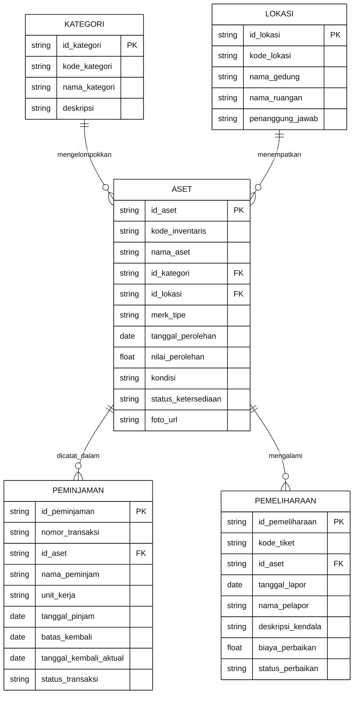
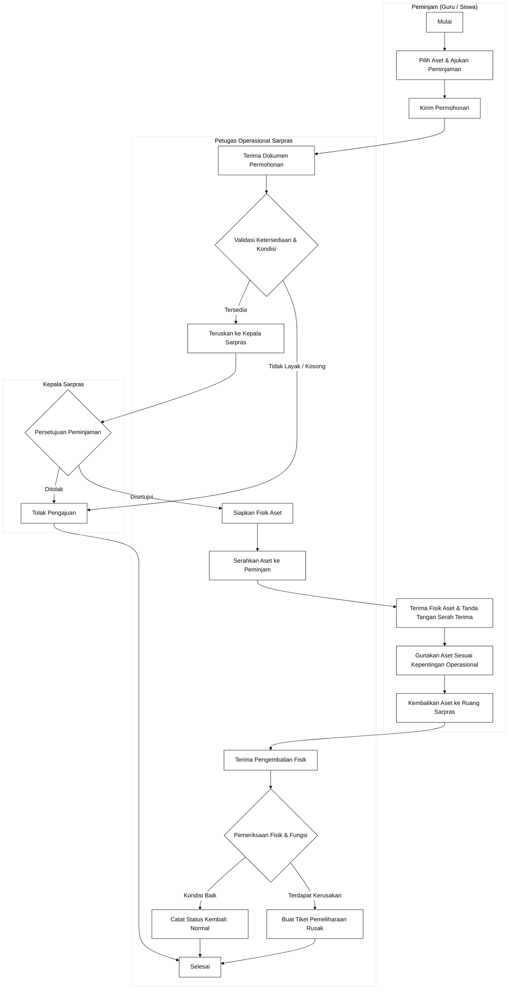
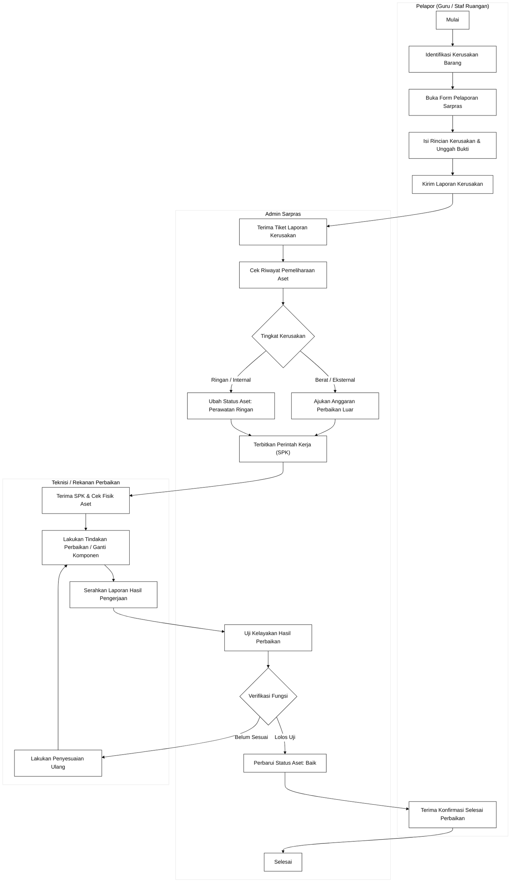
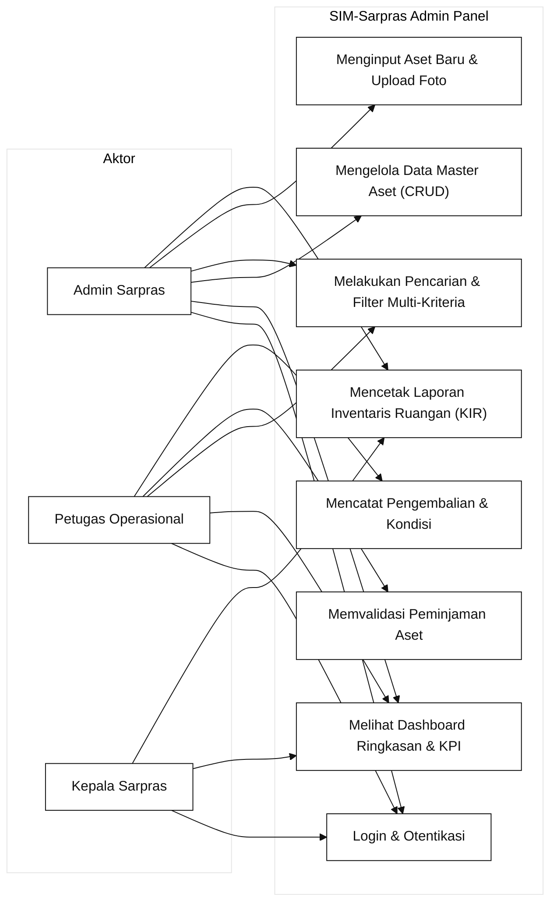
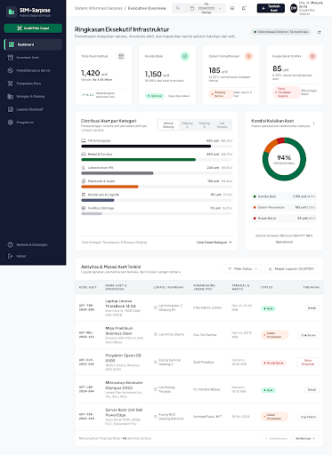
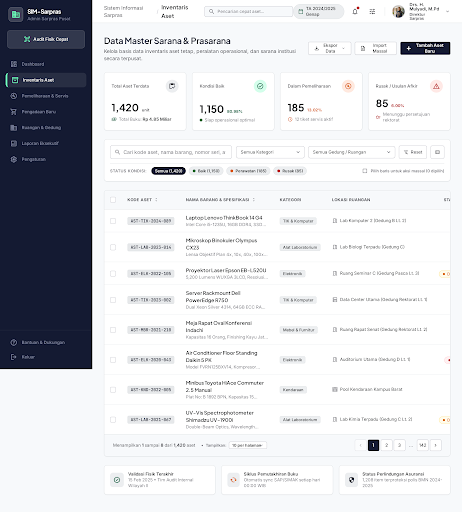
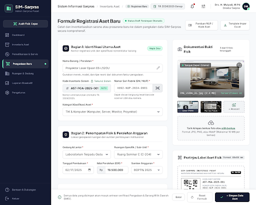
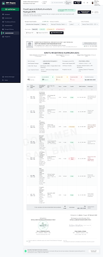
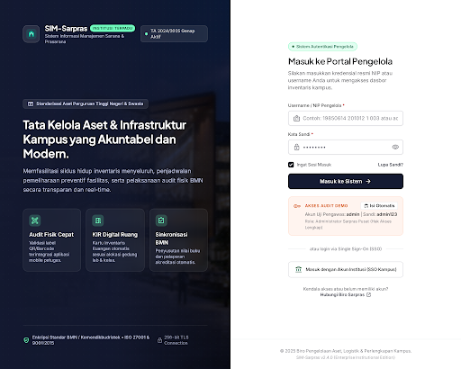

# Dokumen Perancangan Antarmuka Sistem Informasi
## Sistem Manajemen Sarana dan Prasarana (SIM-Sarpras)
**Mata Kuliah:** Pemrograman Web 2  
**Target Milestone:** Milestone 1 (Perencanaan Menu, ER-D, Diagram Swimlane, dan Design System)  
**Pendekatan Arsitektur:** Client-Side Web Application (HTML5, CSS3, Vanilla JavaScript)  
**Tema Desain:** Modern Clean Material Design (Enterprise Back-Office SaaS)  

---

## 1. Deskripsi Sistem dan Ruang Lingkup

### 1.1 Latar Belakang
Sistem Manajemen Sarana dan Prasarana (SIM-Sarpras) adalah aplikasi berbasis web sisi klien (client-side) yang dirancang khusus untuk memfasilitasi pencatatan, pemantauan, pemeliharaan, serta sirkulasi peminjaman aset institusi pendidikan. Sistem ini berfokus pada kejelasan arsitektur informasi, kecepatan akses data operasional, dan kemudahan navigasi bagi pengelola sarana prasarana.

### 1.2 Tujuan Perancangan
1. Mengembangkan tata letak antarmuka admin panel yang responsif, ergonomis, dan mematuhi standar kegunaan (usability) modern.
2. Membangun visualisasi data inventaris (status kelayakan, distribusi kategori, lokasi) yang intuitif menggunakan komponen kartu metrik dan grafik interaktif.
3. Mengeliminasi redundansi pengelolaan data sarpras melalui alur kerja terstruktur mulai dari pencatatan barang, pelaporan kerusakan, hingga penerbitan laporan inventaris.

### 1.3 Karakteristik Pengguna
* **Super Admin / Pengelola Sarpras:** Bertanggung jawab penuh atas pengelolaan data master aset, penambahan barang baru, penentuan lokasi, serta verifikasi penghapusan aset.
* **Petugas Operasional:** Bertugas melayani sirkulasi peminjaman sarana prasarana harian, memvalidasi kondisi pengembalian, dan memperbarui status servis.
* **Kepala Sarpras / Pimpinan:** Memerlukan akses cepat ke ringkasan metrik (dashboard eksekutif) dan lembar cetak laporan pertanggungjawaban aset berkala.

---

## 2. Hirarki dan Struktur Menu (Information Architecture)

Struktur navigasi SIM-Sarpras menggunakan pola navigasi ganda: Sidebar tetap (persistent collapsible sidebar) di sisi kiri untuk navigasi modul utama, dan Header bilah perintah (top command bar) di bagian atas untuk utilitas kontekstual.

```text
SIM-Sarpras Admin Panel
├── 0. Otentikasi (Gerbang Masuk)
│   └── index.html (Halaman Login Admin)
│
├── 1. Dashboard Utama (pages/dashboard.html)
│   ├── Ringkasan Kartu Metrik (Total Aset, Aset Aktif, Dalam Perawatan, Aset Rusak)
│   ├── Visualisasi Distribusi Kategori (Bar Chart)
│   ├── Visualisasi Kondisi Kelayakan Aset (Donut Chart)
│   ├── Log Aktivitas Terkini (Aset Masuk, Peminjaman, Mutasi)
│   └── Ringkasan Persebaran Ruangan / Gedung
│
├── 2. Data Master (pages/data-master.html)
│   ├── Master Aset & Inventaris (Tabel Data, Pencarian, Filter Kategori/Lokasi)
│   ├── Modal Detail Spesifikasi Aset
│   ├── Modal Konfirmasi Hapus Aset (Destructive Guard)
│   └── Export Data (CSV / Print View)
│
├── 3. Formulir Transaksi & Registrasi (pages/form.html)
│   ├── Registrasi Aset Baru (Kode, Nama, Kategori, Lokasi, Sumber Dana, Tanggal)
│   ├── Upload & Pratinjau Foto Fisik Aset
│   ├── Pembaruan Data Aset (Mode Edit)
│   └── Validasi Input Sisi Klien (Real-time Validation)
│
├── 4. Pelaporan & Sirkulasi (pages/laporan.html)
│   ├── Lembar Rekapitulasi Inventaris Ruangan (KIR)
│   ├── Filter Rentang Periode Pengadaan & Mutasi
│   ├── Ringkasan Kondisi dan Valuasi Aset
│   └── Cetak Dokumen Resmi (Format Standar A4 / window.print)
│
└── 5. Utilitas Global (layout.html / Template Dasar)
    ├── Pengalih Mode Tampilan (Sidebar Expand / Collapse)
    ├── Pengalih Tema (Light / Dark Mode Persisten)
    ├── Pencarian Global Cepat
    └── Profil Pengguna Aktif & Logout
```

---

## 3. Konsep Entity Relationship Diagram (ER-D)

Model data logis dirancang untuk mendukung operasional inventaris tanpa dependensi database server (diimplementasikan via JavaScript Data Mock dan Web Storage).



---

## 4. Diagram Alur Kerja Bisnis (UML Activity Diagram Swimlane)

Diagram proses bisnis menggunakan pemodelan swimlane (jalur peran) hitam putih agar batas tanggung jawab antar-aktor terdefinisi secara tegas dan alur eksekusi mudah diverifikasi.

### 4.1 Swimlane Alur Peminjaman dan Pengembalian Sarpras
Diagram ini menggambarkan interaksi antara Peminjam (Guru/Siswa), Petugas Sarpras, dan Kepala Sarpras saat memproses peminjaman aset.



### 4.2 Swimlane Alur Pelaporan Kerusakan dan Pemeliharaan Aset
Diagram ini memetakan tahapan penanganan saat sarana prasarana mengalami kendala fisik atau penurunan performa.



---

## 5. Use Case Diagram Sistem



---

## 6. Design System dan Arsitektur UI (Spesifikasi Teknis)

### 6.1 Fondasi Desain
* **Prinsip Utama:** Clean Material Design for Enterprise SaaS.
* **Fokus UX:** Keterbacaan tinggi pada lembar kerja data padat, pemisahan visual yang tajam antar-status, penekanan visual pada aksi primer, serta nol elemen distraksi visual.

### 6.2 Palet Warna (Color Palette Tokens)
| Token Nama | Nilai HEX | Peran & Penggunaan |
| :--- | :--- | :--- |
| `color-primary` | `#4F46E5` | Warna utama tombol aksi primer, active state navigasi, dan titik fokus visual. |
| `color-primary-hover` | `#4338CA` | State hover tombol primer. |
| `color-secondary` | `#06B6D4` | Aksen sekunder, grafik komparasi, dan visualisasi distribusi lokasi. |
| `color-success` | `#10B981` | Status aset Baik, indikator tren positif, badge disetujui. |
| `color-warning` | `#F97316` | Status Dalam Perawatan, batas pengembalian mendekat, peringatan kalibrasi. |
| `color-danger` | `#EF4444` | Status Rusak Berat, modal konfirmasi penghapusan aset, indikator keterlambatan. |
| `color-bg-canvas` | `#F8FAFC` | Latar belakang kanvas ruang kerja (Clean Slate 50). |
| `color-surface-card`| `#FFFFFF` | Latar belakang kartu kontainer data, tabel, dan formulir. |
| `color-border-hairline`| `#E2E8F0` | Garis batas struktural kartu dan pemisah baris tabel (Slate 200). |
| `color-text-title` | `#0F172A` | Judul utama, angka metrik KPI, dan label penting (Slate 900). |
| `color-text-body` | `#334155` | Teks paragraf, isi sel tabel, dan deskripsi formulir (Slate 700). |
| `color-text-muted` | `#64748B` | Label sekunder, placeholder input, dan penanda waktu (Slate 500). |
| `color-sidebar-bg` | `#0A1128` | Latar belakang bilah navigasi samping (Deep Authoritative Navy). |
| `color-sidebar-hover`| `rgba(255, 255, 255, 0.08)` | Interaksi hover item navigasi sidebar. |

### 6.3 Skala Tipografi (Typography Scale)
* **Font Antarmuka (UI & Display):** `Plus Jakarta Sans`, dengan fallback `Inter, system-ui, sans-serif`.
* **Font Numerik & Kode (Data & Identifier):** `JetBrains Mono`, `Consolas`, monospace (diterapkan dengan `font-variant-numeric: tabular-nums` untuk mencegah pergeseran angka pada tabel dan tanggal).

| Tingkat Tipografi | Ukuran Font | Bobot (Weight) | Jarak Garis (Line Height) | Penggunaan |
| :--- | :--- | :--- | :--- | :--- |
| Heading 1 (Display) | 24px (1.5rem) | Bold (700) | 1.25 | Judul utama halaman (Dashboard, Data Master) |
| Heading 2 (Card Title) | 16px (1.0rem) | SemiBold (600) | 1.35 | Judul bagian kartu data, judul tabel |
| Metric Number (KPI) | 22px (1.375rem) | Bold (700) | 1.2 | Angka ringkasan kuantitas aset di kartu metrik |
| Body Text | 13.5px (0.843rem)| Regular (400) | 1.5 | Teks isi konten, paragraf bantuan form |
| Table Cell Content | 13px (0.812rem) | Medium (500) | 1.4 | Baris data dalam tabel |
| Caption / Meta Tag | 11.5px (0.718rem)| Medium (500) | 1.3 | Timestamp, label kategori kecil |
| Badge Status | 11px (0.687rem) | Bold (700) | 1.0 | Status Baik, Rusak, Perawatan (Pill Tag) |

### 6.4 Komponen Antarmuka Reusable
1. **Tombol Primer (Primary Action):**
   Tinggi tetap 38px, radius 8px, latar `#4F46E5`, teks `#FFFFFF`, transisi fisik saat ditekan (`transform: scale(0.97)`).
2. **Tombol Sekunder (Outline/Ghost):**
   Tinggi tetap 38px, border 1px `#E2E8F0`, latar `#FFFFFF`, teks `#334155`, hover latar `#F1F5F9`.
3. **Field Formulir (Form Input):**
   Tinggi 40px, padding horizontal 14px, border 1px solid `#E2E8F0`, teks `#0F172A`, focus outline aksen `#4F46E5` dengan soft ring 3px `rgba(79, 70, 229, 0.15)`.
4. **Kartu Metrik (KPI Card):**
   Radius 12px, border 1px `#E2E8F0`, padding 18px 20px, bayangan halus `0 1px 3px rgba(15, 23, 42, 0.04), 0 4px 12px -2px rgba(15, 23, 42, 0.03)`.
5. **Badge Status (Pill Chip):**
   Tinggi 22px, padding horizontal 10px, radius 9999px, tipografi 11px bold, warna latar transparan 12% berbasis status semantik.

---

## 7. Rincian Wireframe Layar (Screen Specifications)

### 7.1 Halaman Login (index.html)
* **Tata Letak:** Split-Screen 50:50.
* **Panel Kiri (Visual Identitas):** Foto arsitektur modern beresolusi tinggi dengan overlay transparan navy institusional (`#0A1128`), menampilkan logo resmi SIM-Sarpras, tagline operasional, dan poin keunggulan manajemen fasilitas.
* **Panel Kanan (Formulir Otentikasi):** Kartu login terpusat (max-width 400px), kolom Username/NIP, kolom Kata Sandi dengan ikon toggle intip sandi, opsi Ingat Saya berbasis Web Storage, tombol login primer, dan opsi akses cepat demonstrasi.

### 7.2 Halaman Dashboard (pages/dashboard.html)
* **Bilah Atas:** Ucapan selamat datang personal, tanggal sistem real-time, status profil admin, tombol cepat "+ Tambah Aset".
* **Baris KPI (4 Kartu):**
  1. Total Aset (Kuantitas total beserta persentase pertumbuhan bulanan).
  2. Aset Kondisi Baik (Total sarpras yang siap digunakan).
  3. Dalam Perawatan (Total sarpras dalam proses penanganan teknisi).
  4. Rusak / Butuh Tindakan (Aset kritis yang membutuhkan perbaikan mendesak).
* **Baris Analitik Visual:**
  * Sisi Kiri: Grafik batang (Bar Chart) distribusi kuantitas aset per kategori (Komputer & IT, Elektronik, Furnitur, Peralatan Laboratorium, Kendaraan Dinas).
  * Sisi Kanan: Grafik donat (Donut Chart) rasio kelayakan sarpras (Baik 72%, Rusak Ringan 15%, Rusak Berat 8%, Perawatan 5%).
* **Baris Aktivitas Terkini:** Tabel daftar sirkulasi dan perubahan status aset terbaru dengan timestamp dan pelaksana aksi.

### 7.3 Halaman Data Master (pages/data-master.html)
* **Bilah Kontrol:** Pencarian instan (kode, nama, lokasi), filter dropdown kategori, filter dropdown kondisi kelayakan, dan tombol ekspor data.
* **Tabel Master Aset:**
  * Kolom: Checkbox, Kode Inventaris (monospace), Nama Aset, Kategori, Lokasi/Ruangan, Kondisi Kelayakan (badge), Tanggal Perolehan, Aksi Cepat (Detail, Edit, Hapus).
  * Fitur Interaktif Sisi Klien: Pengurutan kolom (sorting ascending/descending), paginasi dinamis (10 baris per halaman), dan seleksi massal.
* **Modal Dialog:**
  * Modal Detail Aset: Menampilkan rincian teknis lengkap, riwayat servis, dan foto fisik sarpras.
  * Modal Hapus Aset: Dialog konfirmasi bermuatan kritis dengan latar belakang backdrop blur untuk mencegah ketidaksengajaan hapus data.

### 7.4 Halaman Form Registrasi & Edit (pages/form.html)
* **Tata Letak:** Grid 2 kolom seimbang.
* **Kolom Kiri (Spesifikasi Data):** Nama aset, kode registrasi otomatis, pilihan kategori, pilihan lokasi penempatan, nomor seri/NUP, tanggal pengadaan, nilai perolehan (Rupiah format), kondisi awal, dan catatan spesifikasi.
* **Kolom Kanan (Pratinjau Multimedia):** Zona seret-dan-lepas (drag-and-drop) unggah foto aset, thumbnail pratinjau instan sisi klien dengan rasio 16:9, serta kartu rangkuman ringkas sebelum disimpan.
* **Validasi Interaktif:** Penandaan visual merah jika data wajib terlewatkan dan pesan konfirmasi sukses tersimpan.

### 7.5 Halaman Laporan Inventaris (pages/laporan.html)
* **Bilah Parameter:** Pemilihan gedung/ruangan, filter periode pengadaan barang, dan tombol aksi "Cetak Dokumen (Print View)".
* **Lembar Kerja Format Cetak:** Didesain dengan media query `@media print` sehingga saat tombol cetak ditekan, sidebar dan tombol navigasi otomatis tersembunyi, menghasilkan dokumen resmi Kartu Inventaris Ruangan (KIR) siap tanda tangan.

---

## 8. Tautan Rancangan Aktual dan Bukti Wireframe

* **Tautan Publik Google Stitch Project (Aktual & Terverifikasi):**  
  [https://stitch.withgoogle.com/projects/5290689202880346844](https://stitch.withgoogle.com/projects/5290689202880346844)  
  *Nama Project:* SIM Sarpras Asset Management  
  *ID Project:* 5290689202880346844 (Status: Aktif, Digenerate via Google Stitch)

* **Bukti Visual Tangkapan Layar Wireframe (Tersimpan Lokal di Repositori):**
  1. **Dashboard Eksekutif:** `assets/img/stitch_dashboard.png`  
     
  2. **Data Master Inventaris:** `assets/img/stitch_datamaster.png`  
     
  3. **Formulir Registrasi Aset:** `assets/img/stitch_form.png`  
     
  4. **Pusat Laporan & KIR:** `assets/img/stitch_laporan.png`  
     
  5. **Portal Login:** `assets/img/stitch_login.png`  
     

* **Status Tautan Figma:**  
  Rancangan wireframe dan komponen antarmuka resmi berpusat langsung pada Google Stitch Project ID `5290689202880346844` dan file spesifikasi token `docs/DESIGN.md`. Tautan publik Figma dapat disematkan secara mandiri oleh mahasiswa setelah membagikan tautan file Figma kerja pribadi (tidak menggunakan tautan fiktif agar terhindar dari galat 404).

* **Aset Latar Belakang & Grafis:**  
  Tersimpan secara lokal pada repositori: `assets/img/login-bg.jpg` (Arsitektur resolusi tinggi, siap offline).

---
*Dokumen ini disusun sebagai luaran resmi Milestone 1 Tugas Proyek UAS Pemrograman Web 2 dan menjadi acuan baku tahap slicing (Milestone 2) dan implementasi interaktivitas JavaScript (Milestone 3).*
