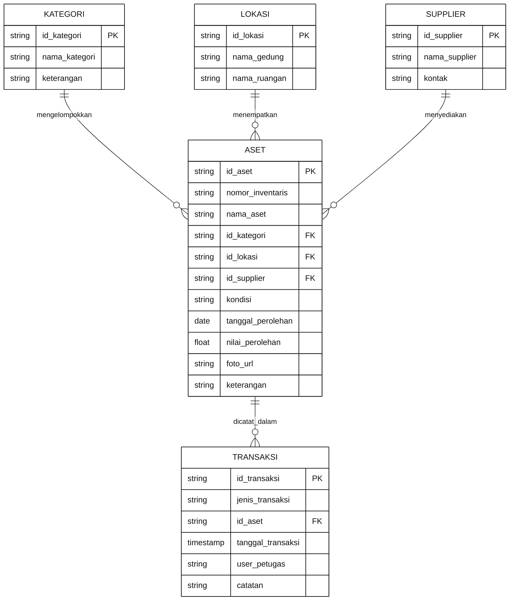
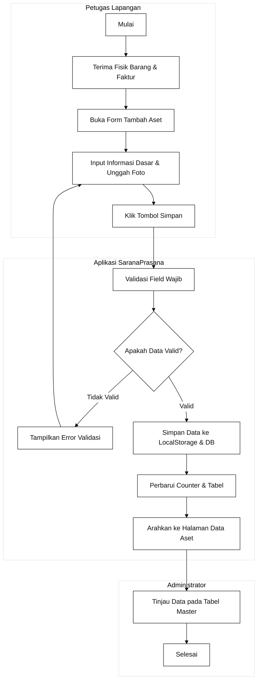
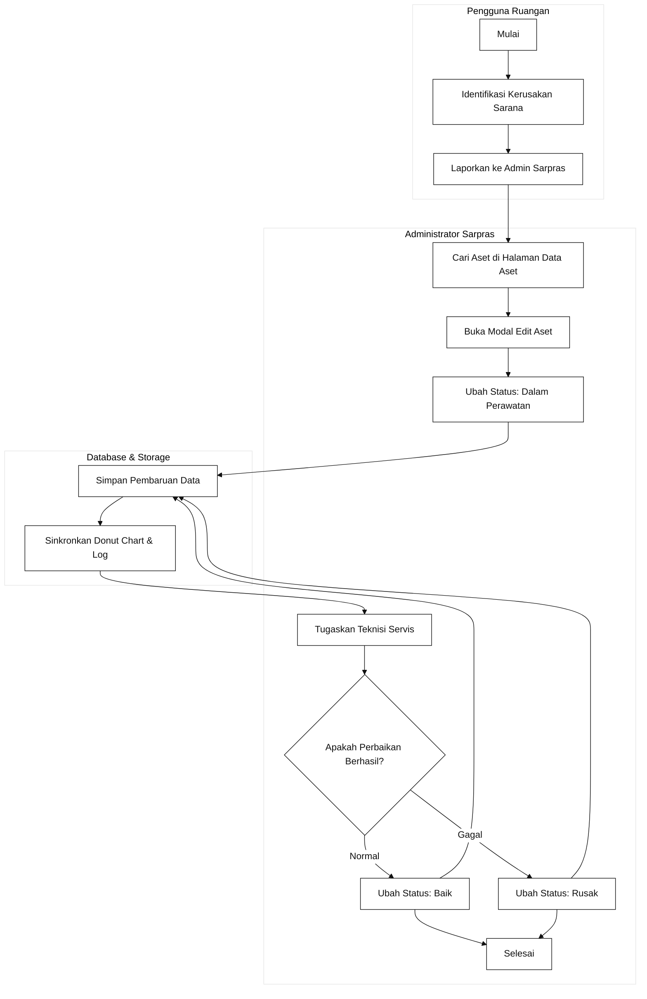
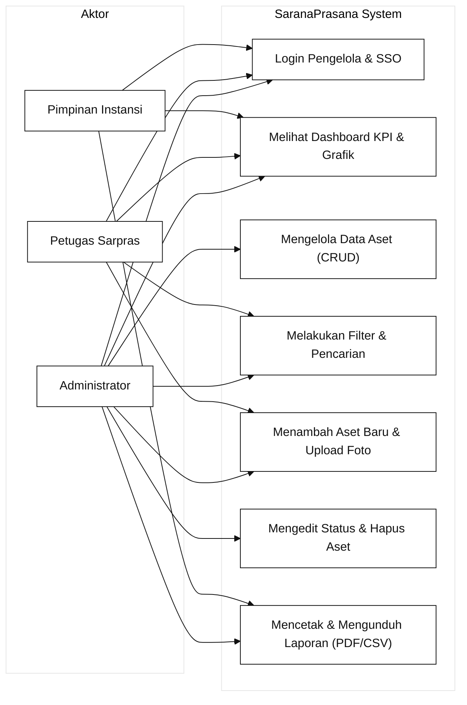

# Dokumen Perancangan Antarmuka Sistem Informasi
## SaranaPrasana - Asset Management (v1.0.0)
**Mata Kuliah:** Pemrograman Web 2  
**Target Milestone:** Milestone 1, 2, dan 3 (Lengkap: Perancangan, Slicing Layout, Interaktivitas, dan Database Docker)  
**Pendekatan Arsitektur:** Client-Side Web Application (HTML5, CSS3, JavaScript) terintegrasi Database Server Docker  
**Tema Desain:** Modern Clean Enterprise SaaS (Sesuai 100% Desain Showcase SaranaPrasana)  

---

## 1. Deskripsi Sistem dan Ruang Lingkup

### 1.1 Latar Belakang
SaranaPrasana (Asset Management v1.0.0) adalah sistem informasi manajemen sarana dan prasarana terpadu yang dirancang untuk mendukung operasional pencatatan, pemeliharaan, mutasi ruangan, serta pelaporan inventaris di lingkungan kampus dan instansi pendidikan. Aplikasi ini menggabungkan antarmuka client-side responsif modern dengan persistensi database PostgreSQL yang berjalan pada kontainer Docker mandiri.

### 1.2 Tujuan Perancangan
1. Merancang antarmuka admin panel yang elegan, bersih, dan berstandar industri berbasis Clean Enterprise SaaS.
2. Menyajikan ringkasan kesehatan inventaris secara visual melalui dashboard KPI real-time (248 Total Aset, 230 Aset Aktif, 8 Aset Rusak, 10 Dalam Perawatan) dan visualisasi grafik interaktif (Chart.js).
3. Mengimplementasikan pengelolaan tabel data master (A-001 s/d A-010) lengkap dengan fitur multi-filter, live search, aksi massal, modal dialog edit, dan modal konfirmasi hapus (destructive guard).
4. Menyediakan formulir registrasi aset dua kolom dengan zona unggah gambar dan validasi input.
5. Menyediakan modul laporan aset yang dapat diunduh (CSV) dan siap dicetak resmi (@media print).
6. Menyediakan integrasi database PostgreSQL 16 pada kontainer Docker baru (saranaprasana-postgres) pada port 5435.

### 1.3 Karakteristik Pengguna
* **Administrator Utama:** Memiliki wewenang penuh mengelola data master aset, menambah barang baru, menyetujui jadwal pemeliharaan, dan mencetak laporan inventaris.
* **Petugas Sarpras:** Melakukan pemeriksaan berkala di lapangan, memperbarui status barang, dan mencatat mutasi ruangan.
* **Pimpinan Instansi:** Memantau ringkasan eksekutif pemanfaatan aset dan nilai kapitalisasi buku sarana prasarana.

---

## 2. Hirarki dan Struktur Menu (Information Architecture)

Struktur menu SaranaPrasana menggunakan sidebar vertikal tetap Dark Slate Navy (#1E293B) di sisi kiri:

```text
SaranaPrasana Admin Panel
├── 0. Portal Autentikasi (index.html)
│   ├── Panel Kiri: Foto Fasad Gedung Modern, Logo Hexagonal SP, & Headline
│   └── Panel Kanan: Form Login (Username, Password Toggle, Ingat Saya, Akses Demo)
│
├── 1. Dashboard Utama (pages/dashboard.html)
│   ├── Welcome Hero Card: Background Foto Gedung Modern, "Selamat Datang, Admin", Pill "Sen, 13 Okt 2025"
│   ├── 4 Kartu Metrik KPI: Total Aset 248, Aset Aktif 230, Aset Rusak 8, Dalam Perawatan 10
│   ├── Visualisasi Grafik Analitik:
│   │   ├── Donut Chart Kondisi Aset: "248 Total Aset" (Baik 72%, Rusak 3%, Perawatan 4%, Hilang 1%, Lainnya 20%)
│   │   └── Bar Chart Kategori: Komputer 60, Kendaraan 45, Alat Kantor 38, Elektronik 32, Furniture 18
│   ├── Widget Aktivitas Terbaru: Log Pengadaan, Pemeliharaan, dan Mutasi
│   └── Widget Lokasi Aset: Gedung A (98), Gedung B (76), Gedung C (42), Luar Gedung (32)
│
├── 2. Data Master (pages/data-master.html)
│   ├── Breadcrumb: Dashboard > Data Master > Aset
│   ├── Header: Judul "Data Aset" & Tombol "+ Tambah Aset"
│   ├── Bilah Filter: Dropdown Kategori, Lokasi, Kondisi, Input Pencarian, Export CSV, Print
│   ├── Tabel Master Aset (10 Data Showcase: A-001 s/d A-010)
│   ├── Modal Edit Aset & Modal Konfirmasi Hapus Aset (Destructive Guard)
│   └── Footer Paginasi: "Menampilkan 1 - 10 dari 248 data", Stepper Pills, 10/halaman
│
├── 3. Tambah Aset Baru (pages/form.html)
│   ├── Header: Judul "Tambah Aset" & Tombol Kembali
│   ├── Kolom Kiri (Informasi Dasar):
│   │   └── Nama Aset, Kategori, Nomor Inventaris, Lokasi, Kondisi, Tgl Perolehan, Supplier, Keterangan
│   ├── Kolom Kanan (Upload Gambar):
│   │   ├── Drag & Drop Zona Upload Foto Aset
│   │   ├── Pratinjau Foto Aset Terunggah
│   │   └── Tombol Aksi: Batal & Simpan
│   └── Validasi JavaScript Interaktif
│
├── 4. Pusat Laporan (pages/laporan.html)
│   ├── Kontrol Header: Rentang Tanggal (01/10/2025 - 31/10/2025) & Tombol Unduh Laporan
│   ├── Mini KPI Row: Total Aset 248, Aktif 230, Rusak 8, Perawatan 10
│   ├── Dual Charts: Ringkasan Kondisi Donut & Aset Terbanyak per Lokasi Bar
│   └── Tabel Detail Laporan Inventaris dengan Tombol Export PDF & window.print()
│
└── 5. Master Layout Template (layout.html)
    ├── Fondasi Slicing Milestone 2 dengan Sidebar Accordion, Header, dan Content Viewport
    └── Modal Dialog Aksesibel
```

---

## 3. Konsep Entity Relationship Diagram (ER-D)



---

## 4. Diagram Alur Kerja Bisnis (UML Activity Swimlane)

### 4.1 Swimlane Registrasi Aset Baru


### 4.2 Swimlane Pemeliharaan dan Perubahan Status


---

## 5. Use Case Diagram Sistem



---

## 6. Design System dan Arsitektur UI (Spesifikasi Showcase)

* **Palet Warna Utama:**
  * Primary: `#1F46E5` (Royal Blue)
  * Secondary: `#06B6D4` (Cyan) | Accent: `#F59E0B` (Amber) | Purple: `#8B5CF6`
  * Success: `#10B981` (Baik) | Warning: `#F97316` (Perawatan) | Danger: `#EF4444` (Rusak)
  * Background: `#F8FAFC` (Slate 50) | Card: `#FFFFFF` | Border: `#E2E8F0`
  * Sidebar: `#1E293B` (Dark Slate Navy)
* **Tipografi:** Keluarga font `Inter` (Bold 24px, Semibold 18px, Medium 16px, Regular 14px, Caption 12px) dipadukan `JetBrains Mono` untuk kode inventaris.
* **Aset Latar Belakang Foto:**
  * `assets/img/login-bg.jpg` (Fasad gedung arsitektur modern beresolusi tinggi, siap offline 100%).
  * Digunakan pada: Sisi kiri halaman Login (`index.html`) dan Welcome Hero Card di Dashboard (`pages/dashboard.html`).

---

## 7. Konfigurasi Database Server Docker

Sistem didukung oleh database PostgreSQL 16 yang berjalan pada kontainer Docker baru dan terisolasi:

* **Nama Kontainer:** `saranaprasana-postgres`
* **Host & Port:** `127.0.0.1:5435` (Port 5435 dipetakan ke 5432 di dalam kontainer)
* **Nama Database:** `saranaprasana`
* **User Database:** `sarpras`
* **Password:** `sarpras_uas_2026`
* **File Skema & Seeding:** `database/schema.sql` (Berisi tabel kategori, lokasi, supplier, aset A-001 s/d A-010, dan transaksi)
* **Skrip Uji Koneksi:** `database/test-db.js` (Jalankan via `npm run test-db` atau `node database/test-db.js`)

---
*Dokumen ini disusun sebagai acuan baku dan luaran resmi Tugas Proyek UAS Pemrograman Web 2.*
